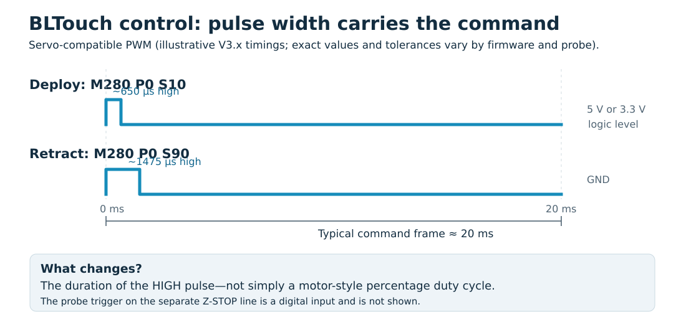
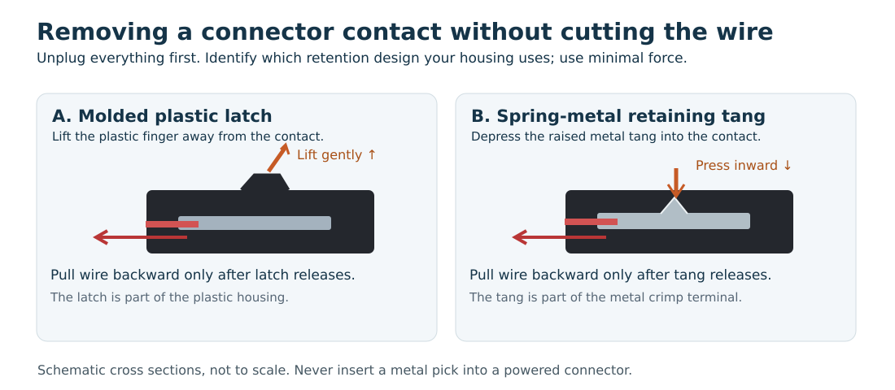

# BLTouch / 3DTouch on Longer LK4, LK4 Pro, and LK5 Pro

**Identify the board, preserve the original firmware, install the probe, verify safe Z homing, and calibrate.**

**Publication status (October 2026):** The manufacturer-documented original LK4 and LGT_KIT installations are included for reference. The MKS Robin E3 V1.1 ESTOP/PB1 + Z-STOP/PC6 arrangement is **proposed and source-reviewed, not yet printer-verified in this fork**. Do not treat a successful compile or a powered probe as proof of safe homing.

## 1. Identify the hardware variant

Longer reused model names across controller revisions. Open the control-board enclosure only **after** powering down, unplugging AC and USB, removing the SD card, and allowing components to discharge.

| Printed motherboard marking | Likely model family | Firmware / connector approach |
| --- | --- | --- |
| Original LONGER LK-series / STM32F103-based controller | Original LK4 | Original Longer LK wiring and firmware |
| LGT_KIT_V1.0 / ATmega2560 | Older LK4 Pro / LK5 Pro | D7 control, ZMIN sensing, serial .hex update |
| MKS Robin E3 V1.1 / STM32F103RCT6 | Newer LK5 Pro | Proposed ESTOP/PB1 control, Z-STOP/PC6 sensing, SD firmware.bin |

Board model, display type, filament-sensor presence, and printhead type (classic or dual blower) must all match the firmware configuration. Other boards, including Robin Nano revisions, require separate documentation.

For the Robin E3 V1.1, use the [official Makerbase pinout PDF](https://github.com/makerbase-mks/MKS-Robin-E3-E3D/blob/master/hardware/MKS%20Robin%20E3%20V1.1_004/MKS%20Robin%20E3%20V1.1_004%20PIN.pdf) and [electrical schematic](https://github.com/makerbase-mks/MKS-Robin-E3-E3D/blob/master/hardware/MKS%20Robin%20E3%20V1.1_004/MKS%20Robin%20E3%20V1.1_004%20SCH.pdf).

## 2. What you will need

- Genuine BLTouch or electrically compatible 3DTouch, appropriately sized 5-wire cable, mounting bracket, screws, and cable ties.
- Screwdrivers, a small needle/connector pin extraction tool, digital calipers, and a **multimeter** with continuity/resistance/DC-voltage modes.
- USB **data** cable, computer, and appropriate SD/microSD card for firmware updates.
- [Pronterface](https://github.com/kliment/Printrun) or [PuTTY](https://www.chiark.greenend.org.uk/~sgtatham/putty/) for G-code and logging.
- [PlatformIO](https://platformio.org/) plus [VS Code](https://code.visualstudio.com/) if compiling Marlin.
- Optional [STM32CubeProgrammer](https://www.st.com/en/development-tools/stm32cubeprog.html), ST-LINK, [AVRDUDE](https://github.com/avrdudes/avrdude), Arduino Uno/Nano, or a compatible Blue Pill probe for readback.
- Optional oscilloscope or logic analyzer for pulse and input-trigger diagnostics.

A typical five-wire cable **carries** +5 V, ground, PWM probe-control pulses, a trigger signal, and a trigger ground. **Do not trust colors alone** on undocumented clone cables. Genuine BLTouch typically uses brown/red/orange for GND/+5V/control and black/white for trigger GND/output. Some clones use green/red/yellow.

## 3. What PWM means for BLTouch

PWM means **pulse-width modulation**. Here, a servo-compatible pulse duration conveys a command. This is **not** conventional motor/LED PWM where an arbitrary duty percentage sets power. Typical genuine V3.x command pulses are about 650 µs for deployment (M280 P0 S10) and about 1475 µs for retraction (M280 P0 S90), in a roughly 20 ms servo-control interval. Probe revisions and firmware timing implementations vary. [ANTCLABS documentation](https://www.antclabs.com/manual) gives the authoritative version-specific timing.

The separate trigger output goes to a motherboard *digital input*. There is no BLTouch SPI, I²C, or UART protocol.

## 4. Preparation: record settings BEFORE opening the printer

### 4.1 Locate the installed firmware version

With covers installed and the printer operating normally, check the startup splash screen and menu entries named **About**, **Information**, **Version**, or **Settings**. Photograph any version string. If the display offers no useful version information, query the firmware using a serial terminal.

### 4.2 Find the printer's serial port

Attach a USB data cable. On Windows, open **Device Manager → Ports (COM & LPT)** and record the COM number. On Linux, run:

~~~sh
ls /dev/ttyUSB* /dev/ttyACM* 2>/dev/null
~~~

The printer may appear as /dev/ttyUSB0 or /dev/ttyACM0. On Linux, use the correct serial-group permissions; avoid running applications as root.

### 4.3 Use Pronterface

Start Pronterface, select the port and installed firmware's baud rate (115200 is typical for documented Longer builds), and click **Connect**. In its command field, enter **M115** and press Enter. Save the reported firmware name and version; then enter **M503** and wait for the complete configuration report.

Copy the output into a plain-text file such as LK5Pro-M115-M503-2026-10-11.txt. M503 reports runtime settings and is **not** a complete firmware dump.

### 4.4 Use PuTTY instead

Close Pronterface first. In PuTTY select **Serial**, enter the COM port or Linux path, choose the correct baud rate, 8 data bits, no parity, one stop bit, and **no flow control**. Before opening the port, select **Session → Logging → Printable output** and choose a file path. Open the session, send **M115** and **M503**, wait for full responses, close the session, and verify the log file. Only one serial host may use a port at a time.

Record the printer model, actual motherboard marking, firmware version, M115/M503 output, original slicer profile, printhead configuration, and screen version where available. Do not issue M500, M501, or M502 as part of this read-only information capture.

## 5. Electrical safety and opening the controller enclosure

Finish logging, stop printing, cool the heaters, turn power off, unplug **AC and USB**, remove the **SD card**, and wait for capacitors to discharge. Open only the low-voltage control-board enclosure, not the mains power-supply enclosure. Photograph all original cable connections before unplugging anything.

Although nominal 24 V DC is a relatively low shock hazard in ordinary dry conditions, a metal screw or slipping tool can short high-current traces or connect 24 V to a 3.3 V/5 V microcontroller input, causing damage, heat, sparks, or fire. USB may back-power board logic even with the printer's main switch off.

### Meter method: identify grounds first

With **all power disconnected**, set a multimeter to continuity or its lowest resistance range. Touch the probes together to establish lead resistance. Touch one probe to a **documented** GND point and the other to the suspect header contact. A stable near-zero-ohm reading generally indicates a common ground. A momentary beep caused by capacitors is not conclusive. Never use ohms/continuity mode on a live PCB.

### Meter method: verify the supply

With the probe disconnected and a secure insulated ground connection, set the meter to DC volts on a range above 5 V. Energize the board only if you can safely contact **one header pin without touching its neighbor**. A documented +5 V rail should measure around +5 V; a 24 V reading is an immediate reason to stop. An idle GPIO also can measure high, so a voltage reading alone does **not** identify a supply rail—check the schematic. Power down and disconnect again before moving wiring.

A continuity check from each cable-end contact to the corresponding probe-end contact proves conductor mapping but **does not prove the probe's undocumented internal pinout**.

## 6. Backup the executable firmware (optional but recommended)

Before modifying firmware, preserve the **matching manufacturer download** even if chip readback is unavailable. See [Longer's downloads](https://www.longer.net/pages/download-software). Save M115/M503 independently.

### 6.1 STM32: Robin E3 V1.1 and original LK4

Use an ST-LINK and STM32CubeProgrammer, with **SWDIO, SWCLK, GND, target reference**, and optionally NRST connected to *verified* points. Target SWD is 3.3 V. Do not assume AUX or EXP headers are SWD.

Check the chip marking and readout-protection state. **Never turn RDP Level 1 into Level 0 merely for backup:** STM32F1 then mass-erases program flash.

For a verified STM32F103RCT6 (Robin E3 V1.1, 256 KiB):

~~~sh
STM32_Programmer_CLI -c port=SWD --upload 0x08000000 0x40000 robin-first.bin
STM32_Programmer_CLI -c port=SWD --upload 0x08000000 0x40000 robin-second.bin
STM32_Programmer_CLI -c port=SWD -ob displ
~~~

For a **physically verified** STM32F103VET6 on an original LK4 (512 KiB), use a length of **0x80000**, not 0x40000. Do not infer chip size merely from the model name.

Compare repeated reads:

~~~sh
wc -c robin-*.bin
cmp robin-first.bin robin-second.bin
sha256sum robin-*.bin
~~~

The Robin E3 V1.1 may use **external EEPROM**. Reading MCU flash will not capture it. Preserve the M503 report and, if needed, read the EEPROM separately using a documented method. A motherboard backup likewise does not automatically capture separate DWIN display firmware.

### 6.2 AVR: LGT_KIT_V1.0 / ATmega2560

First attempt an *unprotected, read-only* bootloader read with AVRDUDE, using the actual serial protocol and baud rate:

~~~sh
avrdude -p m2560 -c wiring -P /dev/ttyUSB0 -b 115200 \
  -n -U flash:r:lgt-flash.bin:r
~~~

The bootloader may not permit all flash or EEPROM to be read. For a more complete backup, an AVR ISP programmer can read flash, EEPROM, fuse bytes, and lock bytes subject to protection.

An **Arduino Uno or classic Nano can be the ISP programmer**. In the Arduino IDE choose **File → Examples → 11.ArduinoISP → ArduinoISP** and upload the example to the *Arduino*, not the printer. With **power removed and the target voltage verified**, connect Uno/Nano D10→target RESET, D11→MOSI, D12→MISO, D13→SCK, and common GND. Use only a verified, compatible target-power arrangement; do not blindly join two 5 V supplies. Some Uno/Nano setups need auto-reset suppression (typically a 10 µF capacitor between programmer RESET and GND **after** uploading ArduinoISP, polarity observed). Read using:

~~~sh
avrdude -p m2560 -c stk500v1 -P /dev/ttyUSB0 -b 19200 -n \
  -U flash:r:lgt-first.bin:r -U eeprom:r:lgt-eeprom.bin:r
~~~

Read a second time; compare binaries. Fuses/lock bits are separate, and an ISP flash read may still be restricted by lock bits. Do **not** click Arduino IDE's **Burn Bootloader** button during backup—it is a write/erase operation. [Official ArduinoISP sketch](https://github.com/arduino/arduino-examples/blob/main/examples/11.ArduinoISP/ArduinoISP/ArduinoISP.ino).

### 6.3 Can an STM32 Blue Pill act as a programmer?

**Yes, with suitable debugger firmware.** A Blue Pill can run [Black Magic Debug](https://black-magic.org/docs/intro/hardware/) and communicate with another STM32 over SWD. This is **not** a standard Arduino sketch, and the Blue Pill must itself first be programmed with compatible firmware. The supported target, available Blue Pill flash size, USB connection, target voltage and exact debugger pins must be checked. A useful third-party implementation is [blackmagic-bluepill](https://github.com/mmoskal/blackmagic-bluepill); its example firmware uses PB0 for SWDIO and PA5 for SWCLK, which is **not universal to all Black Magic builds**.

Once running, Black Magic can attach with arm-none-eabi-gdb and perform a **read-only** GDB memory dump:

~~~text
target extended-remote /dev/ttyACM0
monitor swd_scan
attach 1
dump binary memory robin-first.bin 0x08000000 0x08040000
detach
quit
~~~

Replace the serial port and verify target identification before reading. RDP still applies. A conventional Uno/Nano ArduinoISP sketch **cannot read STM32 SWD flash**; it targets AVR ISP. We recommend ST-LINK for beginners because STM32CubeProgrammer makes device identification and option bytes easier.

### 6.4 Verify and preserve backups

Make two independently obtained files and check sizes and hashes. Save board photos, MCU marking, flash addresses, option/fuse data, settings text, touchscreen resources, software versions, and the OEM package. Keep at least two copies. A full-chip dump usually cannot be substituted for an SD bootloader's application-only firmware file.

Our read-only backup examples and testable helper tools are kept in this fork under [tools/backup](../tools/backup/).

## 7. Physical installation: choose ONE motherboard branch

### 7.1 Original LK4 (original Longer STM32 controller)

[Longer's original LK wiring photograph](https://cdn.shopify.com/s/files/1/0517/8812/0247/files/8_480x480.jpg?v=1631083561)

1. Compare the physical board with the manufacturer photograph. Stop if connectors differ.
2. Download the original board's matching BLTouch firmware via [Longer's LK-series guide](https://www.longer.net/it/blogs/products-tutorial/tutorial-of-bltouch-for-longer-lk1-lk4-lk4-pro-lk5-pro-3d-printer).
3. Photograph and disconnect the mechanical Z-minimum switch.
4. Wire confirmed probe PWM, +5 V, and GND to the matching labeled control connections.
5. Wire probe trigger and trigger ground to ZMIN and GND.
6. Longer's written guide mentions a **50–100 kΩ** pull-up, whereas its diagram mentions a much lower value. **Do not connect an unidentified 5 V pull-up to a 3.3 V MCU GPIO.** A 27 kΩ value is only a possible experiment *after* confirming electrical tolerance and the need for a pull-up; 10 kΩ and 100 kΩ can be examined with scope/logic-analyzer verification if the circuit permits. Failure to respond is not necessarily a resistor problem.
7. Mount the probe, verify cable strain relief, install only the matched firmware, and complete Section 9 before Z homing.

### 7.2 LGT_KIT_V1.0 (older LK4 Pro / LK5 Pro)

[Longer's annotated LGT_KIT_V1.0 photograph](https://cdn.shopify.com/s/files/1/0517/8812/0247/files/mainboard-lk4_pro-lk5_pro_600x600.jpg?v=1612830483)

1. Confirm the board marking and whether the printer has the classic or dual-blower head.
2. Obtain the matching firmware from [Longer's LK4 Pro/LK5 Pro guide](https://www.longer.net/fr/blogs/software/bl-touch-installing-guide-for-lk4pro-lk5pro).
3. Photograph and disconnect the mechanical Z-minimum switch.
4. Wire PWM control to **D7**, power to **5V**, return to **GND**, as labeled on this exact board.
5. Wire trigger output to **ZMIN**, and trigger ground to **GND**.
6. Mount the probe; recheck polarity and tension throughout X-axis travel.
7. Flash the correct **.hex** image using the documented USB/Cura process in Section 11; do not use the Robin E3 firmware.bin method.
8. Complete Section 9.

### 7.3 Makerbase MKS Robin E3 V1.1 (newer LK5 Pro)

[Official V1.1 pinout](https://github.com/makerbase-mks/MKS-Robin-E3-E3D/blob/master/hardware/MKS%20Robin%20E3%20V1.1_004/MKS%20Robin%20E3%20V1.1_004%20PIN.pdf) · [Community installation photo](https://github.com/DreadedZombie/LK5Pro-1.0.3E3-Marlin2.X-Firmware/blob/main/LK5%20Pro%20BLtouch%20Pin%20Locations.png)

#### Why did Longer use the BLTouch and NeoPixel connections for the LCD?

The DWIN screen communicates with the STM32 through a **UART**. USART2 uses **PA2 (TX)** and **PA3 (RX)**, which the standard Robin E3 layout brings out near the NeoPixel and BLTouch functions. Longer's display wiring takes advantage of those available UART-capable GPIOs.

The STM32F103 also offers USART1 (**PA9 TX / PA10 RX**, used by the board's host/USB serial connection) and USART3 (**PB10 TX / PB11 RX**, with PB10 used by the filament-runout input in the LK5 Pro firmware). The pins' other duties, PCB routing, and header availability mean these are **possible alternative peripherals**, not two guaranteed drop-in display connectors.

Given the popularity and usefulness of automatic bed leveling, why not route the LCD to another UART and reserve the original BLTouch connector? We cannot establish Longer's actual design rationale from the public documentation. Reusing an existing USART2 route might have minimized wiring, firmware changes, or manufacturing cost. The question is reasonable; a definite claim about Longer's motives would not be.

On the documented LK5 Pro configuration, **leave the original LCD and filament-detection wires installed**. The proposed alternative uses ESTOP/PB1 for PWM and Z-STOP/PC6 as the probe trigger:

| Probe function | Cable color on one common clone harness | Board |
| --- | --- | --- |
| +5 V | Red | ESTOP pin 1 |
| GND | Green | ESTOP pin 2 |
| PWM control | Yellow | ESTOP pin 3, PB1 |
| Trigger | White | Z-STOP pin 1, PC6 |
| Trigger GND | Black | Z-STOP pin 2, GND |

**Verify physical header orientation and the probe's own electrical pinout.** This table is functional mapping, not a plug-facing pin-number picture.

#### Step-by-step physical wiring

1. Compare the board marking and populated headers to the official drawing.
2. Keep the original BLT/LCD, NeoPixel/LCD, and MTDET/filament-sensor connections.
3. Verify ESTOP 5 V and GND against the schematic and multimeter procedure. Confirm PB1 is the control contact.
4. If the three-wire housing order is wrong, unplug all power and extract/rearrange **only the required contacts**:

   

   Inspect the latch: some 2.54 mm housings have a **molded plastic finger to lift**; others use a **spring-metal tab to depress**. Push the wire slightly *into* the housing to unload the catch, touch the correct latch with a small needle, then gently withdraw the terminal by its wire. Never pry forcibly on the contact. Reinsert until retained and tug lightly to verify. [Additional illustrated explanation](https://kerryburton.com/dupont-connectors/).
5. Disconnect and label the mechanical Z-endstop connector.
6. Connect probe trigger to Z-STOP/PC6, with the correct ground.
7. Connect verified +5 V, ground, and PWM control to ESTOP.
8. Mount and secure the probe cable; verify clearance.
9. **Before applying power to an undocumented clone, its supply polarity and output-level compatibility must be positively established.** In particular, verify trigger output compatibility with the STM32's 3.3 V input.

## 8. Marlin: exact beginner procedure for the Robin E3 V1.1

This section applies to the [Monotoba fork](https://github.com/Monotoba/LK5Pro-1.0.3E3-Marlin2.X-Firmware) of [DreadedZombie's LK5 Pro Marlin source](https://github.com/DreadedZombie/LK5Pro-1.0.3E3-Marlin2.X-Firmware). **It does not apply to unrelated stock Longer firmware.**

### Step 1 — Get the source and make a development branch

Install Git, Python/PlatformIO, or VS Code with the PlatformIO extension. Then:

~~~sh
git clone https://github.com/Monotoba/LK5Pro-1.0.3E3-Marlin2.X-Firmware.git
cd LK5Pro-1.0.3E3-Marlin2.X-Firmware
git checkout -b feature/bltouch-estop-zmin
~~~

Keep an unmodified main branch as a rollback reference.

### Step 2 — Build the original baseline

From the project directory:

~~~sh
pio run -e mks_robin_e3_maple
~~~

If this fails, investigate the toolchain before changing configuration.

### Step 3 — Enable the probe in Configuration.h

Open **Marlin/Configuration.h**. Around the top of the file, near the Longer printer-selection macros, locate:

~~~cpp
// #define WITH_Z_PROBE
~~~

Two forward slashes mean a C/C++ **comment**: the compiler ignores that line. Remove *only those two slashes* so it reads:

~~~cpp
#define WITH_Z_PROBE
~~~

Save the file. This project uses WITH_Z_PROBE to conditionally enable BLTOUCH, bilinear leveling, and Z safe homing. Do **not** add another copy of the definition elsewhere.

### Step 4 — Check the physical pin definitions

Open **Marlin/src/pins/stm32f1/pins_MKS_ROBIN_E3_common.h** and find:

~~~cpp
#if HAS_Z_SERVO_PROBE
  #define SERVO0_PIN PB1
#endif

#define Z_MIN_PIN PC6
#define Z_MIN_PROBE_PIN PC1  // pseudo-probe definition in source
#define FIL_RUNOUT_PIN PB10
~~~

These are macro **definitions**; they are not G-code commands. The expected control and trigger are PB1 and PC6.

The source's PC1 *pseudo-probe* definition is potentially confusing. Do **not** change it to PA2 merely because the board has a separate probe header. We chose **Z_MIN_PROBE_USES_Z_MIN_ENDSTOP_PIN**, which means the physical Z-minimum input PC6 must be used for sensing. There is a separate PA2 probe-input arrangement, but it is not our selected configuration.

### Step 5 — Check the conditional endstop setting

In **Marlin/Configuration.h**, search for **Z_MIN_PROBE_USES_Z_MIN_ENDSTOP_PIN**. With WITH_Z_PROBE enabled, the block must read:

~~~cpp
#if ENABLED(WITH_Z_PROBE)
  #define Z_MIN_PROBE_USES_Z_MIN_ENDSTOP_PIN
#endif
~~~

Also search for **BLTOUCH**, **AUTO_BED_LEVELING_BILINEAR**, and **Z_SAFE_HOMING**. Ensure the project's conditional definitions for these features are enabled by WITH_Z_PROBE. The separate USE_PROBE_FOR_Z_HOMING directive may be enabled automatically by Z_MIN_PROBE_USES_Z_MIN_ENDSTOP_PIN in Marlin; check the build's actual resolved configuration.

### Step 6 — Check for an unexpected probe-pin override

From the project root:

~~~sh
grep -RniE 'define (SERVO0_PIN|Z_MIN_PIN|Z_MIN_PROBE_PIN|Z_MIN_PROBE_USES_Z_MIN_ENDSTOP_PIN|FIL_RUNOUT_PIN)' Marlin/Configuration.h Marlin/src/pins
~~~

**This is a source-inspection aid, not a complete preprocessor test.** You may see definitions for other boards or code behind inactive conditions; that is normal. The real checks are that the **selected board** is BOARD_MKS_ROBIN_E3_V1_1, control resolves to PB1, the active Z-minimum sensing connection is PC6, and no other enabled feature claims those GPIOs.

Use the tests and compile diagnostics supplied with this fork. If in doubt, inspect the compiler's preprocessed configuration or add a targeted compile-time assertion, rather than assuming a grep match proves a setting is active.

### Step 7 — Measure offsets and check trigger polarity

Probe offsets depend on the **actual bracket**. Do not copy another owner's default. Check the probe's idle and triggered input behavior before deciding whether inversion settings need changing. Never force a 5 V trigger level into a pin that cannot tolerate it.

### Step 8 — Rebuild and review

~~~sh
pio run -t clean -e mks_robin_e3_maple
pio run -e mks_robin_e3_maple
~~~

Check warnings, firmware size, and generated filenames. A successful compile does **not** prove safe Z homing.

Commit the minimal firmware changes with a descriptive message and add a test result to CHANGELOG.md and readme-fork.md. Do not publish a ready-to-flash release until on-printer checks pass.

## 9. Probe testing: keep the glass safe

**Yes, a hard nozzle crash can crack, chip, or break a glass build plate**, particularly under a concentrated load. For initial probe and Z-motion safety testing on a glass-bed LK5 Pro, **remove and safely store the glass**. Protect the exposed metal surface with a stable, flat, nonmetallic sacrificial test surface where appropriate. Remember: removing the glass changes the effective bed height—**this is not the final Z-offset calibration**.

Do not place fingers beneath a moving hotend to act as the probe target. Start with probe deploy/retract and trigger tests while the Z carriage is stationary and well above the bed. Prefer noncontact observation or a secured test target rather than trying to catch a descending nozzle. Use a physical power-off switch if a controlled test fails. Restore the original glass only after the trigger-stop behavior has been demonstrated, then calibrate with glass in place.

### Reference G-code commands

| Command | Meaning / when to use |
| --- | --- |
| M115 | Read firmware identity and capabilities |
| M503 | Report current runtime settings |
| M119 | Report configured endstop and probe states |
| M280 P0 S10 | Deploy a compatible BLTouch |
| M280 P0 S90 | Retract the probe |
| M280 P0 S120 | Self-test (compatible devices) |
| M280 P0 S160 | Clear alarm (compatible devices) |
| G28 | Home axes; **do not use until the probe trigger is proven** |
| G28 X Y | Home X and Y; safe only after those original endstops are checked |
| G28 Z | Home Z; safety-critical after probe retrofit |
| M851 | Report or set the probe Z offset |
| M114 | Report current position |
| M211 S0 / S1 | Disable / re-enable software endstops; hazardous when disabled |
| G29 | Generate leveling mesh (if enabled) |
| M420 S1 | Enable saved leveling mesh (when valid) |
| M500 | Store supported settings to nonvolatile memory |

### Safe test order

1. With the toolhead high, send **M280 P0 S10** and **M280 P0 S90**, confirming deployment/retraction without Z movement.
2. Send **M119** while idle. For probes that produce short pulses, M119 alone may not prove trigger capture; verify the trigger signal with a logic analyzer or a controlled test suited to the firmware.
3. Check X/Y homing and travel without moving Z toward the bed.
4. Establish **independently** that the deployed probe trigger reaches the **active PC6 Z-minimum logic** and that firmware responds by stopping motion. Do not use a downward homing command as your first electrical trigger test.
5. Only after those checks, carry out a supervised controlled Z-home with ample clearance, no glass for preliminary protection, and a safe test target.
6. Reinstall the glass for final offset calibration once motion reliably stops.

## 10. Z-offset calibration: Longer's method and a safer approach

[Longer's official calibration guide](https://www.longer.net/fr/blogs/software/bl-touch-installing-guide-for-lk4pro-lk5pro) instructs: clean the nozzle and bed; send **M851 Z0**; issue **G28**; command **G1 F60 Z0**; send **M211 S0** to disable software endstops; step Z in 0.1 mm increments over paper; read **M114**; set **M851 Z...**; store using **M500**; restore **M211 S1**; home again; and verify paper drag at Z0.

This sequence assumes safe working probe homing. **M211 S0 removes an important software safety barrier**, and automatically moving to Z0 after an initial zero offset may put the nozzle into the build surface. The original instructions should not be treated as a safe first power-on test for an undocumented clone.

**Safer alternative:** After validated homing, restore the glass and use Marlin's Z-offset wizard or babystepping feature **if the installed firmware provides it**. Make only small corrections while the nozzle is within a controlled distance of the bed. Otherwise use Pronterface to approach in carefully limited increments, observe the nozzle-to-glass clearance, and change M851 under explicit supervision. Keep software endstops enabled unless a small negative movement is genuinely required, and **always restore M211 S1 immediately** when that operation ends. Measure the resulting offset, save with M500, and verify by rehoming cautiously before the first-layer test.

Use X/Y offsets measured from nozzle to probe with calipers and observe the reachable probe area. The exact position depends on whether the printer has a classic or dual-blower mount.

## 11. Firmware update and recovery: board-specific

### 11.1 LGT_KIT_V1.0 (AVR, .hex over USB)

[Longer's step-by-step firmware update guide](https://www.longer.net/fr/blogs/software/longer-lk4-pro-lk5-pro-3d-printer-firmware-update) specifies:

1. Download the **exact** LK4 Pro/LK5 Pro firmware package matching the motherboard and head.
2. Connect the powered printer to the computer using the USB data cable and start a supported version of Cura.
3. Select **Monitor**, then **Manage Printers** for the configured printer.
4. Find **Update Firmware**, choose **Upload Custom Firmware**, and select the correct **.hex** file.
5. Maintain power and USB connectivity while updating; wait for completion; reboot and verify M115/M503.

**Recovery:** If the board's serial bootloader still responds, repeat the matched .hex update in Cura. If it does not, an ISP programmer can restore a *verified matching* full-flash image (including bootloader, if captured), subject to fuse/lock settings and correct target voltage. **Do not burn an unrelated Arduino Mega bootloader** merely because the target is an ATmega2560. Preserve MCU fuses and lock bits; do not blindly overwrite them.

### 11.2 Robin E3 V1.1 (STM32, SD card firmware.bin)

The [DreadedZombie project README](https://github.com/DreadedZombie/LK5Pro-1.0.3E3-Marlin2.X-Firmware) documents:

1. Build with **pio run -e mks_robin_e3_maple**.
2. Open **.pio/build/mks_robin_e3_maple/** and locate **Robin_e3.bin**.
3. Copy it to a new file named **firmware.bin** (exact case) in the root of a **FAT32** SD card.
4. With printer power off, insert the card into the **motherboard's** SD slot.
5. Power on and allow the board's bootloader to update; do not interrupt power.
6. Confirm firmware version and verify all existing functions *before* attempting Z homing.
7. Remove any remaining firmware.bin from the card or use a clean print SD card on the next boot.

These are the **upstream project's stated filename and procedure**, not a guarantee that every factory bootloader accepts every image. Keep the original OEM firmware and a verified flash dump before trying this.

**Recovery:** If the bootloader still works, reinstall a known-good, matching **firmware.bin** using the same procedure. If the bootloader has been damaged or is absent, an ST-LINK SWD programmer may restore a **verified full-chip flash dump** at the correct base address; an application-only firmware.bin is not necessarily an equivalent restoration image. Do **not** clear STM32 RDP Level 1 to read the old code; doing so erases it.

### 11.3 Original LK4 STM32

Use the [original Longer LK-series firmware resources](https://www.longer.net/it/blogs/products-tutorial/tutorial-of-bltouch-for-longer-lk1-lk4-lk4-pro-lk5-pro-3d-printer) for the exact motherboard; do **not** automatically substitute either the LGT .hex/Cura procedure or Robin E3 firmware.bin/SD method. The documented installation methods and any serial bootloader behavior vary by controller revision.

**Recovery:** First use the manufacturer's matching firmware package and verified update procedure if the original bootloader operates. If not, use an SWD programmer only after confirming MCU marking, flash capacity, pinout, readout protection, and the correct restoration address. A verified full-flash dump may permit exact recovery; restoring a similarly named board's binary is unsafe.

### 11.4 DWIN touchscreen

The Robin E3 LK5 Pro has a separately programmed DWIN touchscreen. A motherboard update does **not** automatically update its display code or graphics. Archive the matching screen resources before change; do not flash an unrelated DWIN asset pack while troubleshooting the probe.

## 12. Bed leveling and slicer start G-code

Only after successful probe homing and Z-offset calibration:

~~~gcode
G28     ; home using verified probe
G29     ; generate mesh
M500    ; save supported settings
~~~

For an already saved valid mesh, compatible Marlin firmware commonly uses **G28** followed by **M420 S1**, or it can perform **G29** for every print. Preserve the slicer's original preheat, positioning, and purge commands instead of replacing the entire start block blindly. Verify safe probe offsets, bed clips, and travel boundaries.

## 13. Troubleshooting

- **No light / probe heats up:** Stop; verify correct 5 V and ground and probe connector identity.
- **Probe lights but does not deploy:** Verify PWM assignment (PB1 on the proposed E3 setup), control waveform, and firmware enable setting.
- **Probe deploys but Z does not stop:** Stop immediately; confirm digital trigger path to PC6 and firmware's active Z-min endstop logic. Do not repeat a blind home.
- **LCD stops communicating:** Restore the original BLT/NeoPixel display connections and verify LCD_SERIAL_PORT.
- **Filament-runout failure:** Confirm MTDET/PB10 is unchanged.
- **Firmware flash fails:** Verify board revision, correct image format, exact filename, bootloader, and selected update method.
- **Readback blocked:** Do not disable protection if it would mass erase firmware.
- **First layer wrong:** Recalibrate with the **glass installed** after all safety tests.

## 14. Further reading and attribution

- [LONGER original LK-series BLTouch guide](https://www.longer.net/it/blogs/products-tutorial/tutorial-of-bltouch-for-longer-lk1-lk4-lk4-pro-lk5-pro-3d-printer)
- [LONGER LK4 Pro / LK5 Pro guide](https://www.longer.net/fr/blogs/software/bl-touch-installing-guide-for-lk4pro-lk5pro)
- [LONGER firmware update through Cura](https://www.longer.net/fr/blogs/software/longer-lk4-pro-lk5-pro-3d-printer-firmware-update)
- [LONGER mesh leveling with a stored mesh](https://www.longer3d.com/blogs/software/mesh-bed-levelling-for-lk4pro-lk5pro)
- [Makerbase Robin E3/E3D hardware](https://github.com/makerbase-mks/MKS-Robin-E3-E3D)
- [ANTCLABS BLTouch specifications](https://www.antclabs.com/bltouch-v3) and [manuals](https://www.antclabs.com/manual)
- [Marlin G-code documentation](https://marlinfw.org/meta/gcode/)
- [GeoCyberwolf older LK4 Pro BLTouch firmware](https://github.com/GeoCyberwolf/LK4Pro-Marlin1.1.9-BLTouch)
- [DreadedZombie Robin E3 V1.1 firmware](https://github.com/DreadedZombie/LK5Pro-1.0.3E3-Marlin2.X-Firmware)
- [Monotoba's ongoing firmware fork](https://github.com/Monotoba/LK5Pro-1.0.3E3-Marlin2.X-Firmware)
- [Black Magic Debug Blue Pill platform](https://black-magic.org/docs/intro/hardware/)
- [ArduinoISP original example](https://github.com/arduino/arduino-examples/blob/main/examples/11.ArduinoISP/ArduinoISP/ArduinoISP.ino)
- [Dupont connector retention illustration and explanation](https://kerryburton.com/dupont-connectors/)
- [Community Robin E3 V1.1 installation experiences](https://www.reddit.com/r/Longer3d/comments/192lj1b/longer_lk5_pro_with_mks_robin_e3_v_11/)

**Editorial caution:** Initial hardware safety tests, complete firmware readback, and recovery are board/revision dependent. Do not imply that a generic STM32 image, protected readout, or incompatible bootloader can be recovered by blindly writing a file.

*Revision: 2026-10-11. Firmware/probe validation pending.*
